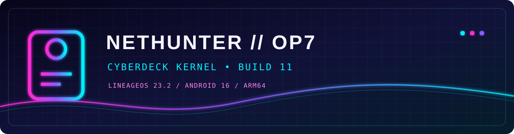

<p align="center">
  
</p>

<p align="center">
  <a href="https://github.com/neonbytecode/oneplus7pro-nethunter-kernel/releases"></a>
  <a href="docs/INSTALL.md"></a>
  <a href="docs/MODULES.md"></a>
</p>

# OnePlus 7 Pro NetHunter Kernel


Kali NetHunter kernel and safe on-demand modules for the OnePlus 7 Pro (`GM1911`) running LineageOS 23.2 / Android 16.

> This release is device- and ROM-specific. Read the compatibility and recovery instructions before flashing.

## ◈ Cyberdeck status

| ◉ Core | ⚡ Runtime | 🛡 Safety | 📡 Wireless |
| --- | --- | --- | --- |
| `4.14.357` / arm64 | Magisk 30.7 | on-demand modules | Wi‑Fi tested |
| build11 / Clang 21 | Android 16 | rollback verified | external monitor adapter recommended |

The visual theme is cosmetic: the kernel remains a conservative, recovery-first build. Add-ons are present but do not auto-load during boot.

## Release highlights

- Kernel: `4.14.357-v0lk3n-SM8150_OP7Serie-LOS_23.2+`
- Build11, arm64, Clang/LLD 21.1.8
- Android boot header v2, 4096-byte pages, 20-DTB blob
- PSTORE/ramoops, KPROBES, UVC gadget, RD_XZ/RD_LZ4
- CIFS, NTFS, ISO9660, UDF, SquashFS, IFB, NETEM, TBF, USB serial, CAN, HWSIM and related modules
- Add-ons are installed but never auto-loaded; this protects boot and Wi-Fi stability
- Tested normal boot, Magisk, Wi-Fi association, Internet connectivity and controlled on-demand module loading

## Download

Always verify `SHA256SUMS` before use.

| Artifact | Purpose |
| --- | --- |
| `boot-nh-advanced-build11-gzip.img` | Flashable build11 boot image |
| `nh-kernel-addons-build11-safe-fixed.zip` | Magisk module with 21 on-demand `.ko` files |
| `config-build11` | Exact kernel configuration |
| `SHA256SUMS` | Integrity manifest |

## Compatibility

| Item | Tested value |
| --- | --- |
| Device | OnePlus 7 Pro, `GM1911/GM1913` |
| ROM | LineageOS 23.2 |
| Android | 16 |
| Architecture | arm64 |
| Boot target | `boot_b`, 100,663,296 bytes |
| SELinux | Permissive during testing |

Other variants, ROMs, firmware revisions, DTB blobs and partition layouts are not guaranteed.

## Quick start

1. Read [`docs/INSTALL.md`](docs/INSTALL.md) and make a boot-partition backup.
2. Verify downloads with `shasum -a 256 -c SHA256SUMS`.
3. Confirm the model, ROM, slot and partition size.
4. Flash the boot image and reboot.
5. Install the Magisk module ZIP.

Modules are loaded manually, for example:

```sh
su -c 'sh /data/adb/modules/nh-kernel-addons/load-on-demand.sh squashfs'
```

## Documentation

- [Installation and recovery](docs/INSTALL.md)
- [Build from source](docs/BUILD.md)
- [Module catalog and on-demand loading](docs/MODULES.md)
- [Troubleshooting](docs/TROUBLESHOOTING.md)
- [Security and publishing policy](docs/SECURITY.md)
- [Repository file map](docs/FILES.md)
- [Changelog](docs/CHANGELOG.md)
- [Contributing](docs/CONTRIBUTING.md)

## Source and licensing

The build is based on `V0lk3n/nethunter_kernel_oneplus_sm8150`, branch `nethunter-lineage-23.2`, with documented compatibility fixes. Preserve all upstream GPL and third-party notices. Corresponding source, patches and build environment must be available when redistributing binaries.

## Recovery promise

If a test fails, restore the saved boot image immediately from fastboot. Do not continue experimenting without a known-good recovery path.
